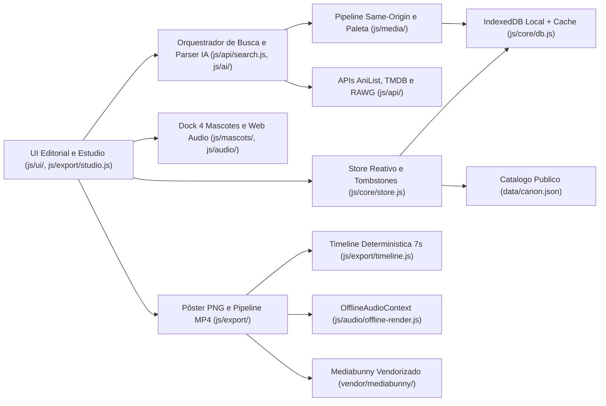

# CANON

Câmara de curadoria editorial pessoal para **jogos, filmes, séries e animes** — aplicação web estática **100% client-side** em HTML, CSS e JavaScript puro com ES Modules (sem backend, sem build step e sem CDNs em runtime), hospedada na pasta [`canon/`](https://github.com/dyduq12/dyduq12/tree/main/canon) do repositório [`dyduq12/dyduq12`](https://github.com/dyduq12/dyduq12). Quando o GitHub Pages desse repositório estiver ativado, a URL pública esperada é `https://dyduq12.github.io/dyduq12/canon/` *(a confirmar)*.

> **Capturas de tela:** *(a adicionar após validação visual em dispositivos reais; consulte [`docs/VERIFICACAO_MANUAL.md`](docs/VERIFICACAO_MANUAL.md)).*

---

## Recursos

- **Banco híbrido (`data/canon.json` + IndexedDB):** mescla o catálogo público inicial com criações, edições e *tombstones* locais do navegador, incluindo fallback transparente em memória com aviso explícito e exportação/importação versionada de `canon.json`.
- **Cards editoriais com flip 3D e acessibilidade:** frente com capa local, título e ficha técnica adaptada por mídia; verso com 5 barras de critérios, prós, contras, status e selo **Hall da Fama** (`>= 9,0`), alternável por ponteiro (R3) e teclado (`Enter`/`Espaço`), mantendo a face oculta com `inert`.
- **Busca em APIs externas + cache com TTL:** integração com **AniList** (GraphQL POST com fila deslizante de 30 req/min e tratamento de `HTTP 429`), **TMDB** (filmes/séries + créditos) e **RAWG** (jogos com fallback de cache e entrada manual em falha CORS). Chaves de API ficam armazenadas exclusivamente no IndexedDB do usuário.
- **Importação "Colar da IA":** cópia de prompt estruturado (com fallback manual para iOS), parser tolerante com erros específicos por campo, prévia somente leitura e enriquecimento opcional via API preservando todas as notas em caso de falha.
- **Motor determinístico de mascotes & áudio procedural:** **KOMA**, **SAVE**, **KINO** e **ECHO** simulados por molas (`dt = 1/60`, PRNG com semente), síntese Web Audio em tempo real (mudo inicial, desbloqueio síncrono no gesto), vibração opcional e pausa automática quando a aba fica oculta ou fora da viewport.
- **Estúdio de Exportação (Pôster PNG & Vídeo Story MP4):**
  - **Pôster PNG (`1080×1350`):** layout editorial puro + desenho Canvas 2D usando apenas capas same-origin (R2), pré-renderizado para compartilhamento nativo síncrono via `navigator.share`.
  - **Vídeo MP4 (`1080×1920`, `7,0 s`):** renderização determinística quadro a quadro e trilha pré-sintetizada via `OfflineAudioContext`, codificados no cliente com **Mediabunny `1.66.4`** (`vendor/mediabunny/`), verificação prévia `canEncodeVideo`/`canEncodeAudio`, degradação progressiva (`60 → 30 fps` e modo sem áudio quando AAC não existe), `MessageChannel` yield, cancelamento limpo com `AbortController` e `wakeLock` progressivo.
- **Blindagem mobile e de erros:** temas **Papel Fosco** e **Ardósia Noturna** em `css/tokens.css`, `100vh`/`100dvh`, `safe-area-inset-*`, catálogo central de mensagens de erro acionáveis, lembrete de backup (`> 7` dias) e solicitação progressiva de `navigator.storage.persist()`.

---

## Stack Tecnológica

- **Frontend:** HTML5 semântico, CSS3 com tokens centralizados (`css/tokens.css`) e JavaScript ES Modules puro (zero frameworks, zero bundler, zero CDN em runtime).
- **Armazenamento e Mídia no Cliente:** IndexedDB, Blob WebP same-origin (`600×900`), quantização de paleta (`32×32`), Canvas 2D, Pointer Events, Web Audio API (`AudioContext` + `OfflineAudioContext`) e Web Share API.
- **Codificação MP4 em Browser:** `mediabunny@1.66.4` (`MPL-2.0`) vendorizado em [`vendor/mediabunny/`](vendor/mediabunny/) e carregado sob demanda via `import()` dinâmico.

---

## Arquitetura



---

## Como rodar localmente e testar

Pré-requisito: **Node.js `>= 20`** (`v24+` testado localmente).

> **Aviso importante:** `file://` **não é suportado**, pois ES Modules e `fetch('./data/canon.json')` exigem origem HTTP. Utilize sempre o servidor estático local incluído (`scripts/serve.mjs`), que também simula o subpath `/canon/`.

```bash
# 1. Subir o servidor estático local (porta padrão 4173)
npm run serve
# Abrir no navegador: http://localhost:4173/canon/

# 2. Rodar toda a suíte automatizada de testes (Node test runner)
npm test

# 3. Rodar o smoke test HTTP recursivo simulando /canon/
npm run smoke
```

> **Nota para Windows PowerShell:** se a política de execução bloquear `npm.ps1`, execute `npm.cmd run serve`, `npm.cmd test` e `npm.cmd run smoke`.

---

## Como adicionar obras e exportar o `canon.json`

1. Adicione obras pelo formulário (**Nova obra**), pela busca em API ou pelo painel **Colar da IA**.
2. Todas as alterações locais (obras, capas normalizadas e tombstones) são salvas no **IndexedDB** do navegador.
3. Clique em **Exportar `canon.json`** no cabeçalho para baixar seu backup portátil (**chaves de API nunca são incluídas** no arquivo exportado).
4. Para atualizar o catálogo público padrão do site, substitua [`data/canon.json`](data/canon.json) pelo arquivo exportado (removendo referências `cover:*` exclusivas do IndexedDB ou usando caminhos locais em `covers/`) e publique no repositório.

> **Aviso:** as 3 obras iniciais presentes em [`data/canon.json`](data/canon.json) são registros fictícios/ilustrativos usados para demonstração e testes do motor.

---

## Como publicar no GitHub Pages

O projeto já inclui caminhos 100% relativos à subpasta, arquivo [`.nojekyll`](.nojekyll) isolado dentro de `canon/` e o bundle [`vendor/mediabunny/`](vendor/mediabunny/) versionado:

1. Código-fonte hospedado em: <https://github.com/dyduq12/dyduq12/tree/main/canon> (branch `main`).
2. No GitHub do repositório `dyduq12/dyduq12`, acesse **Settings → Pages**.
3. Em **Build and deployment → Source**, selecione **Deploy from a branch**.
4. Escolha a branch **`main`** e a pasta **`/ (root)`**, e salve (sem alterar arquivos fora de `canon/`).
5. Quando o GitHub Pages estiver ativo, o endereço esperado será `https://dyduq12.github.io/dyduq12/canon/` *(a confirmar)*.

---

## Decisões de Arquitetura & Documentação

Consulte [`docs/README_DOCS.md`](docs/README_DOCS.md) para o índice completo de documentação, [`docs/SEGURANCA.md`](docs/SEGURANCA.md) para auditoria e proposta de CSP, [`docs/VERIFICACAO_MANUAL.md`](docs/VERIFICACAO_MANUAL.md) para o roteiro em dispositivos reais e [`docs/adr/`](docs/adr/) para os 14 ADRs (`0001` a `0014`).

---

## Limites Conhecidos

- **AniList em modo degradado:** requisições passam por fila de até `30 req/min` com backoff em `HTTP 429`; em rajadas intensas a resposta pode demorar.
- **RAWG / CORS:** chamadas diretas do navegador à RAWG podem sofrer bloqueio de CORS dependendo da configuração da API/rede; quando isso ocorre, o CANON recorre ao cache local e mantém o preenchimento manual. (Comportamento em múltiplos provedores móveis ainda não confirmado em dispositivo real.)
- **Áudio AAC no Safari iOS:** `AudioEncoder` WebCodecs nativo só está disponível a partir do **iOS 26+**. Em versões anteriores do Safari iOS, a exportação MP4 degrada automaticamente para **vídeo sem áudio** com aviso explícito (nunca substituindo por Opus/MP3 sem compatibilidade confirmada).
- **Persistência em navegadores móveis:** navegadores podem descartar dados do IndexedDB caso o site fique longo período sem uso sem concessão automática de `navigator.storage.persist()`; mantenha backups regulares via `canon.json`.
- **Escopo reservado para refinamento posterior:** tipografia editorial final, diagramação definitiva de jornal, granulado refinado, arte SVG definitiva dos 4 mascotes, coreografia/trilha final do vídeo MP4 e capturas de tela reais.

---

## Atribuições e Licenças

- **TMDB:** *This application uses TMDB and the TMDB APIs but is not endorsed, certified, or otherwise approved by TMDB.* (<https://www.themoviedb.org/>)
- **RAWG:** Metadados de jogos fornecidos por **[RAWG](https://rawg.io/)**.
- **AniList:** Metadados de animes via **[AniList](https://anilist.co/)** GraphQL API.
- **Mediabunny (`1.66.4`):** Biblioteca client-side de codificação/muxing MP4 licenciada sob **MPL-2.0** — <https://mediabunny.dev/> ([cópia local da licença](vendor/mediabunny/LICENSE)).

### Licença do CANON

`Copyright (c) 2026 Eduardo Borborema Brito`  
A licença em [`LICENSE`](LICENSE) (**Eduardo Borborema Source-Available & Non-Commercial License v1.0**) vale exclusivamente para a pasta **`canon/`** (componentes de terceiros permanecem sob suas respectivas licenças, incluindo `MPL-2.0` do Mediabunny em `vendor/mediabunny/`).
